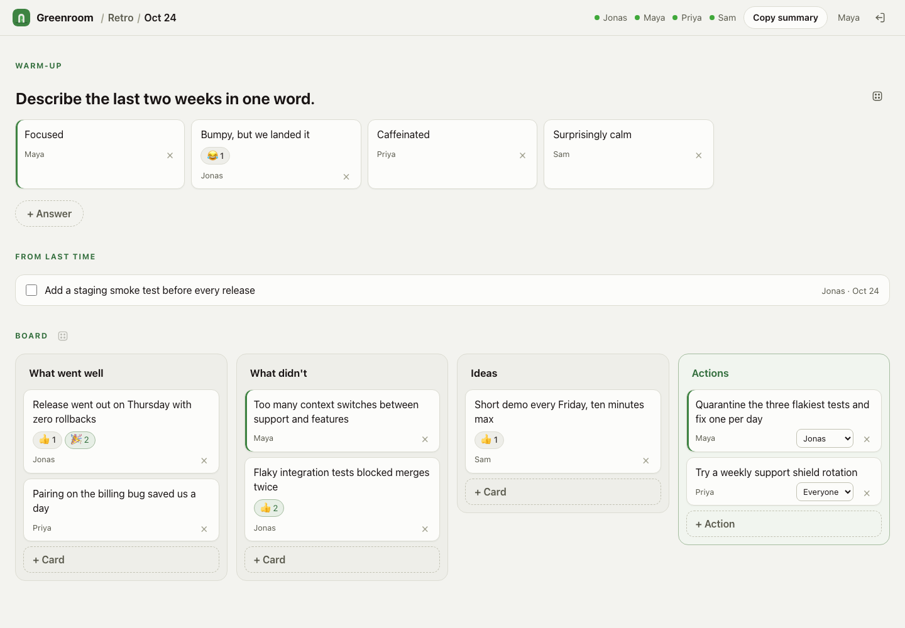

<p align="center">
  <a href="https://moored.dev"></a>
</p>

<h1 align="center">Moored</h1>

<p align="center">
  Meet-style retro rooms in one self-hosted binary.<br>
  Create a room, share the link, export the retro for your agent.
</p>

<p align="center">
  <a href="https://moored.dev"><b>Try it live at moored.dev</b></a>
  &nbsp;·&nbsp;
  <a href="#run">Run your own</a>
  &nbsp;·&nbsp;
  <a href="CHANGELOG.md">Changelog</a>
</p>

<p align="center">
  <a href="https://github.com/markbrutx/moored/actions/workflows/ci.yml"></a>
  <a href="https://github.com/markbrutx/moored/releases/latest"></a>
  <a href="https://github.com/markbrutx/moored/pkgs/container/moored"></a>
  <a href="LICENSE"></a>
</p>



## How it works

1. **Create a room.** Type your name and pick who can come in: *Ask to join*
   (default) or *Open*. You get a link like `https://moored.dev/abc-defg-hij`.
2. **Share the link.** People type their name. In an *Ask to join* room you see
   "Maya wants to join" and click Admit or Deny; they get in without
   reloading.
3. **Run the retro.** Warm-up question, an anonymous happiness check, board
   columns from a template set, cards, reactions and actions with an owner,
   all live.
4. **Export for your agent.** *Copy .md* puts the whole retro on the
   clipboard as Markdown, ready for a prompt; *Download .md* saves it.
5. **Delete it.** The host deletes the room for everyone. Rooms also delete
   themselves after 7 days without activity.

No accounts and no passwords. The host can switch the room between open and
closed, remove people, and open the room as host on another device with a
private host link.

[moored.dev](https://moored.dev) runs the latest release on one small server.
Use it as is, or run your own copy inside your network.

## Run

```sh
docker run -d -p 8080:8080 -v moored:/data ghcr.io/markbrutx/moored
```

Or download a binary for Linux, macOS or Windows from the
[releases](https://github.com/markbrutx/moored/releases/latest) and run:

```sh
./moored
```

Then open <http://localhost:8080>. Coming from Greenroom 0.3? Read the
[upgrade notes](docs/deploy.md#upgrade).

## Config

| Variable | Default | |
| --- | --- | --- |
| `MOORED_ADDR` | `:8080` | Listen address |
| `MOORED_DATABASE_URL` | `sqlite:moored.db` | SQLite file |
| `MOORED_ROOM_TTL` | `168h` | Delete rooms after this long without activity |
| `MOORED_TRUSTED_PROXIES` | `127.0.0.1,::1` | Proxies allowed to set `X-Forwarded-For` |
| `MOORED_TLS_CERT`, `MOORED_TLS_KEY` | | Serve HTTPS directly |
| `MOORED_NAME` | `moored.dev` | Name in the top bar |
| `MOORED_LOGO` | built-in | Logo file: SVG, PNG, WebP, JPEG or ICO |
| `MOORED_ACCENT` | neutral | Accent color, `#rrggbb` |
| `MOORED_TZ` | `UTC` | Time zone for dates |
| `MOORED_TEMPLATES` | built-in | Your own [pool.toml](internal/retro/pool.toml) |
| `MOORED_LOG_LEVEL`, `MOORED_LOG_FORMAT` | `info`, `text` | Logging |

Production setup: [docs/deploy.md](docs/deploy.md), or one EC2 instance with
[deploy/aws](deploy/aws/README.md). Security notes: [SECURITY.md](SECURITY.md).

License: MIT
